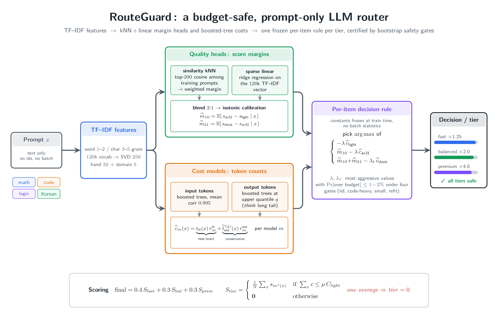

<!--
SPDX-FileCopyrightText: Copyright 2026 seon_ha_01
SPDX-License-Identifier: Apache-2.0
-->

# Efficient LLM Routing Challenge

[](https://www.youtube.com/watch?v=ftQNM1NlzQA)

프롬프트만 보고 세 후보 모델(`ax31-light`, `ax31`, `axk1-think`) 중 하나를 골라,
정해진 예산 안에서 답변 품질을 최대한 끌어올리는 라우터입니다. 모델을 직접
호출하지는 않고, 각 모델이 미리 만들어 둔 답 중 하나를 선택하는 방식입니다.

세 등급(fast, balanced, premium)마다 예산 한도가 있고, 한 등급이 한도를 넘으면
그 등급은 0점이 됩니다. 최종 점수는 등급 점수의 가중 평균으로, 가중치는
fast 0.4, balanced 0.3, premium 0.3입니다.

## 이 라우터가 하는 일

문항마다 독립적으로, "더 큰 모델로 바꾸면 점수가 얼마나 오르는가"와 "비용이
얼마나 드는가"를 예측해서 기대 품질에서 비용 벌점을 뺀 값이 가장 큰 모델을
고릅니다. 벌점 상수는 학습 때 정해 굳혀 두므로 실행 중에 배치 통계를 쓰지
않고, 같은 프롬프트는 입력 순서와 무관하게 항상 같은 모델로 갑니다. 신경망이나
인터넷 없이 numpy만 쓰는 작은 오프라인 컨테이너로 돌아갑니다.



<details>
<summary>동작 방식 자세히</summary>

- 품질 예측: 프롬프트를 단어·문자 TF-IDF와 SVD 벡터로 바꾼 뒤, light 대비
  ax31, ax31 대비 think의 기대 점수차 두 개를 예측합니다. 비슷한 학습 질문들의
  점수차를 빌려오는 이웃 방식과 희소 선형 회귀를 섞고, 등화 보정으로 실제 점수
  단위에 맞춥니다.
- 비용 예측: 입력 토큰 수는 프롬프트 길이로 거의 정해지니 그대로 쓰고, 불확실한
  출력 토큰은 평균이 아니라 상위 분위수로 잡아 답이 길게 나오는 꼬리를 흡수합니다.
- 결정 규칙: 문항마다 세 모델의 "기대 품질 − 벌점 × 예상 비용"을 비교해 가장 큰
  쪽을 고릅니다. 등급별 벌점 상수는 학습 데이터의 재표집 검사(무작위, 코드 편중,
  작은 평가셋, 재학습 편차)를 모두 통과하는 가장 공격적인 값으로 학습 때
  고정합니다. 데이터가 코드로 치우쳐 답이 길어져도 한도를 넘지 않습니다.

라우터 본체는 [`src/ossp_router/model_router.py`](src/ossp_router/model_router.py)와
[`src/ossp_router/textfeat.py`](src/ossp_router/textfeat.py),
결정성 회귀 테스트는
[`tests/test_model_router_determinism.py`](tests/test_model_router_determinism.py)에 있습니다.
</details>

## 실행

```bash
for t in fast balanced premium; do
  PYTHONPATH=src python -m ossp_router.model_router \
    --input data/dev/inputs-base.json --tier $t --output out/$t.json
done
```

## 실험 리포트

공개 Dev 868문항으로 평가했습니다. 868문항은 공개 Dev 880문항 중 원문을 재배포할 수
있는 프롬프트이고, 수학 경시대회(AIME) 12문항은 원문 재배포가 불가해 뺐습니다.
아래 RouteGuard 수치는 **Train만으로 학습하고 상수를 고정한 holdout** 결과입니다.
제출본은 Fast·Premium 헤드를 Train + Dev로 다시 학습해 Dev 점수(0.716)가 낙관적입니다.

### 결과

각 칸은 `점수 / 비용비`(전부 light일 때 비용 대비)이고, 한도는 Fast 1.25, Balanced 2, Premium 4입니다.

| 방법 | Fast | Balanced | Premium | 최종 |
| --- | ---: | ---: | ---: | ---: |
| 전부 light | 0.628 / 1.000 | 0.628 / 1.000 | 0.628 / 1.000 | 0.628 |
| prompt-heuristic (대회 baseline) | 0.634 / 1.068 | 0.667 / 1.397 | 0.701 / 2.247 | 0.664 |
| feature-budget (대회 baseline) | 0.629 / 1.029 | 0.632 / 1.366 | 0.701 / 2.247 | 0.652 |
| hash-regex (대회 baseline) | **초과** / 1.267 | **초과** / 2.055 | **초과** / 4.258 | 0 |
| **RouteGuard (holdout)** | **0.674** / 1.221 | **0.705** / 1.932 | **0.738** / 3.777 | **0.702** |

- 전부 light 대비 +11.9%, prompt-heuristic 대비 등급별 +0.040 [0.024, 0.056],
  +0.038 [0.022, 0.055], +0.037 [0.023, 0.052] (같은 문항끼리 짝지은 부트스트랩 4,000회, 95% CI).
- hash-regex는 공개 Dev 880문항에 맞춰 안전계수를 정한 baseline이라 880에선 0.695로
  통과하지만, 868문항에선 세 등급 모두 넘고 대회 측 비공개셋 사전 검증에서도
  Premium이 넘었습니다([baselines/README.md](baselines/README.md)). 같은 880에서 RouteGuard는 0.693입니다.

### 구성요소 분석 (ablation)

변형마다 λ의 배율만 바꿔 Dev의 *예측* 비용비를 전체 모델과 같게 맞춘 뒤 비교했습니다
(Dev 결과는 λ에 쓰지 않음). 실행: `python3 scripts/ablation.py`.

| 변형 (하나만 바꿈) | Fast | Balanced | Premium | 최종 | 전체 대비 |
| --- | ---: | ---: | ---: | ---: | ---: |
| RouteGuard (전체) | 0.674 / 1.221 | 0.705 / 1.932 | 0.738 / 3.777 | 0.702 | 기준 |
| 품질: Ridge만 | 0.672 / 1.227 | 0.700 / 1.885 | 0.737 / 3.767 | 0.700 | −0.002 |
| 품질: kNN만 | **초과** / 1.302 | 0.704 / 1.914 | 0.737 / 3.726 | 0.432 | −0.270 |
| isotonic 보정 제거 | **초과** / 1.296 | 0.680 / 1.843 | 0.705 / 2.867 | 0.416 | −0.287 |
| 품질 헤드 제거 (상수 이득) | 0.671 / 1.215 | **초과** / 2.127 | 0.716 / 3.285 | 0.483 | −0.219 |
| think 제외 | 0.674 / 1.221 | 0.701 / 1.931 | 0.701 / 2.247 | 0.690 | −0.012 |
| 안전 여유 제거 (예측 비용비 = 한도) | **초과** / 1.264 | **초과** / 2.055 | **초과** / 4.699 | 0 | −0.702 |
| 참고: 평균 비용(MSE regression) 예측 + 여유 없음 | **초과** / 1.304 | **초과** / 2.044 | **초과** / 5.062 | 0 | −0.702 |

- 안전 여유를 빼면 점수는 조금 오르지만 세 등급 모두 한도를 넘습니다.
- 같은 계획 비용이어도 고르는 문항이 바뀌면 실제 비용이 달라집니다: kNN만, isotonic 제거,
  품질 헤드 제거는 한 등급씩 한도를 넘습니다.

### 예측기 크기 실험

비용은 실제값으로 고정하고 품질 예측기만 바꾼 Fast 등급 모의 실험입니다(light → ax31 승격만,
예측 이득 ÷ 추가 비용 순으로 한도까지 승격). 파라미터를 38개에서 960만 개로 키워도
점수는 0.666~0.680이고, RouteGuard 품질 헤드와의 차이는 모두 신뢰구간이 0을 포함합니다.

| 품질 예측기 | 파라미터 | Fast 모의 점수 | RouteGuard 대비 차이 (95% CI) |
| --- | ---: | ---: | ---: |
| hand-crafted 37개 + Ridge | 38 | 0.6676 | [−0.0134, +0.0023] |
| GBDT-500 | 31,500 | 0.6665 | [−0.0197, +0.0058] |
| MLP-S | 75,521 | 0.6777 | [−0.0069, +0.0122] |
| TF-IDF 12만 + Ridge | 120,001 | 0.6754 | [−0.0063, +0.0110] |
| kNN-200 | — (학습 파라미터 없음) | 0.6766 | [−0.0036, +0.0063] |
| RouteGuard 품질 헤드 | 120,001 | 0.6737 | 기준 |
| MLP-L | 1,351,681 | 0.6783 | [−0.0027, +0.0094] |
| MLP-XL | 4,800,513 | 0.6797 | [−0.0012, +0.0111] |
| MLP-XXL | 9,596,929 | 0.6760 | [−0.0040, +0.0078] |

### 비용 헤드와 예산 초과 위험

| 모델 | 입력 토큰 상관 | 출력 log-상관 | 커버리지 q = 0.75 | 커버리지 q = 0.85 |
| --- | ---: | ---: | ---: | ---: |
| light | 0.998 | 0.811 | 65.1% | 71.8% |
| ax31 | 0.998 | 0.888 | 66.1% | 74.4% |
| think | 0.997 | 0.701 | 66.1% | 74.7% |

커버리지는 실제 출력 토큰이 예측 분위수 이하인 비율입니다. λ는 Train을 3,000번 재표집한
네 가지 상황에서 초과 확률이 1~2% 이하가 되도록 정했지만, 학습에 쓰지 않은 Dev를 재표집하면
초과 확률이 Fast 11%, Balanced 30%, Premium 33%로 더 높습니다
(hash-regex는 54%, 62%, 73%, 4,000회 재표집 기준). 여유가 얇다는 점이 남은 한계입니다.

### 재현

```bash
python3 scripts/train_all.py      # 공개 데이터 → 배포 파일 6단계, CPU 약 7분, 시드 고정
python3 scripts/ablation.py       # 구성요소 분석
python3 scripts/analyze.py        # 공식 채점기 대조, 대회 baseline 재현
```

## 대회 규칙과 채점

자세한 규칙, 데이터, 채점 방식, 실행 한도는 `docs/` 아래 문서를 참고하세요.

- [docs/CHALLENGE_RULES.md](docs/CHALLENGE_RULES.md) — 과제 규칙
- [docs/SCORING.md](docs/SCORING.md) — 채점 방식
- [docs/RUNTIME.md](docs/RUNTIME.md) — 컨테이너 실행 한도
- [docs/SUBMISSION.md](docs/SUBMISSION.md) — 제출 절차
